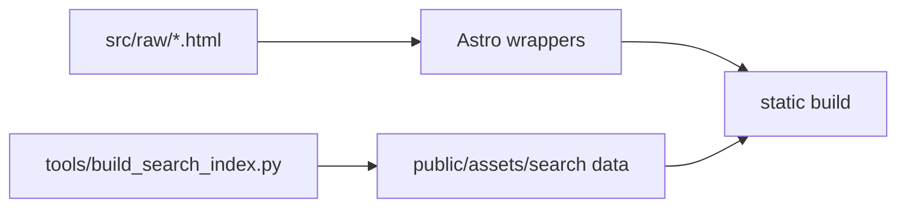

<div align="center">

# The Open Studio

**A free photography and crafts reference library.**

[](https://adineo-cmd.github.io/the-open-studio/)
   

[](https://github.com/adineo-cmd/the-open-studio/stargazers) [](https://github.com/adineo-cmd/the-open-studio/commits)

[Live site](https://adineo-cmd.github.io/the-open-studio/) · [Quick start](#quick-start) · [How it works](#how-it-works) · [Features](#features)

</div>

---

Fifteen pages on genres, exposure, composition, light, editing, gear,
history, masters, the business of shooting and learning paths — plus
client-side search.

The editable sources are plain HTML; Astro wraps them in one shared shell.

## Features

| | Feature | What it does |
| --- | --- | --- |
| 📷 | **70+ genres** | Catalogued by subject, approach and place, with twelve profiled in depth. |
| 💡 | **Craft fundamentals** | Exposure, composition, lighting, editing and gear, each on its own page. |
| 🖼️ | **History and masters** | A timeline from camera obscura to computational photography. |
| 💼 | **Going pro** | Portfolio, clients, pricing, contracts, rights, stock and prints. |

## How it works

The site is a passthrough build:

1. `src/raw/*.html` holds the authored pages and one shared stylesheet.
2. `src/pages/*.astro` wraps each raw page in the layout.
3. `tools/build_search_index.py` regenerates the client-side search data.
4. Astro emits the final static site.



## Quick start

**Install and run**

```bash
npm install
npm run dev
```

**Production build**

```bash
npm run build
npm run preview
```

## Project structure

```text
src/raw/       editable HTML pages
src/pages/     Astro wrappers for all fifteen pages
public/assets/ stylesheet and search data
tools/         search index builder
_SPEC.md       authoring blueprint
```

## Deployment

Every push to `main` builds the site and deploys it to GitHub Pages
through `.github/workflows/deploy.yml`:

**https://adineo-cmd.github.io/the-open-studio/**

The output is fully static — no server, no database, no runtime environment
variables.

## Editing

```bash
python3 tools/build_search_index.py   # regenerate search data
npm install
npm run dev                          # local preview
npm run build                        # production build to dist/
```

`_SPEC.md` is the authoring blueprint: skeleton, classes and canonical anchors.
